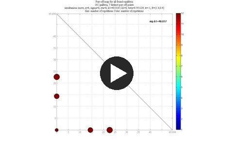
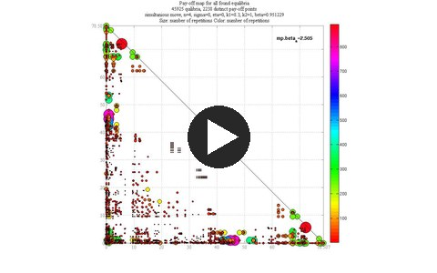
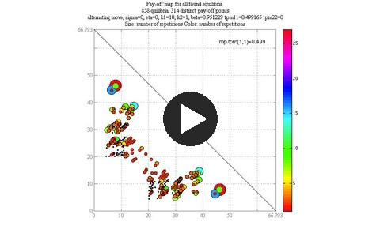
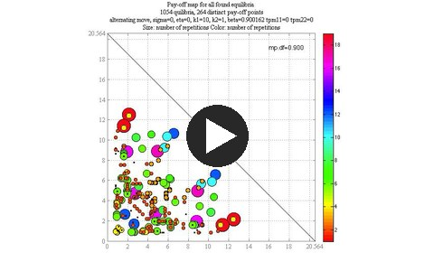

Every estimator of the last two classes broke down somewhere when the game had several
equilibria. Today we meet a class of dynamic games where all equilibria can be found, an
algorithm that finds them, and a maximum likelihood estimator built on it.

(rls-intro)=
## Why all equilibria?

- Maximum likelihood for a game, by NFXP or by MPEC, needs to search over **all**
  equilibria at every trial value of the parameters, as
  [Class 24](24_mpec.md#games-static-cliffs) showed; anything less risks the wrong
  equilibrium and a likelihood cliff.
- In general no algorithm finds all equilibria of a dynamic game: successive
  approximations find only stable ones, homotopy follows one path, MPEC finds local optima.
- Many games of interest have a **direction**: technology only improves, a patent race
  only moves forward, an adoption base only grows. In such games the equilibrium problem
  splits into a sequence of small problems, and all equilibria can be enumerated.
- The example of the class is a dynamic Bertrand duopoly in which firms invest to
  **leapfrog** each other, inspired by the collusion case of the Australian packaging
  producers Amcor and Visy.

(rls-model)=
## The leapfrogging game

The setup:

- two Bertrand competitors, no entry or exit, discrete time, infinite horizon, a common
  discount factor $\beta \in (0, 1)$
- each period each firm chooses a **price** and whether to **buy the state-of-the-art
  technology**
- a continuum of consumers buys each period from the cheaper firm: no switching costs

The **technology**:

- the state-of-the-art marginal cost $c$ starts at $c_0$ and can only improve,
  $0 \leqslant c \leqslant c_0$, discretized with $n$ points
- it follows an exogenous Markov process $\pi(c_{t+1} \mid c_t)$ with
  $\pi(c_{t+1} \mid c_t) = 0$ whenever $c_{t+1} > c_t$
- a firm that pays the investment cost $K(c)$ produces with marginal cost $c$ from the next
  period on

The **state** of the game is the cost structure $(c_1, c_2, c)$ with $c_1 \geqslant c$ and
$c_2 \geqslant c$: the costs of the two firms and the state of the art, common knowledge.
Each firm also receives private extreme value shocks $\eta \varepsilon_{i,I}$ and
$\eta \varepsilon_{i,N}$ to the payoffs of investing and not investing, with a scale
$\eta \geqslant 0$; for $\eta > 0$ the investment probabilities are logit.

Bertrand pricing gives the cheaper firm the cost difference and the other firm nothing.
With $j$ the rival of firm $i$, the profit of the period is

$$
r_i(c_1, c_2) =
\begin{cases}
0, & c_i \geqslant c_j , \\
c_j - c_i, & c_i < c_j ,
\end{cases}
$$

with the price $\max(c_1, c_2)$. Investment decisions are made either **simultaneously**,
or in **alternating** fashion, when a right-to-move state $m \in \{1, 2\}$ that follows its
own Markov process says which firm may invest.

The strategies are Markovian behavior strategies $\sigma_i = \big(p_i(c_1, c_2, c),
P^I_i(c_1, c_2, c)\big)$: the Bertrand price and the probability to invest.

````{attention} Definition (MPE of the leapfrogging game)
A **Markov perfect equilibrium** is a strategy profile $\sigma^\star = (\sigma^\star_1, \sigma^\star_2)$
and value functions $V_i(c_1, c_2, c)$ such that the Bellman equations of both firms hold,
and each $\sigma^\star_i$ is a best response to $\sigma^\star_j$ that puts positive probability
only on the maximizers of the Bellman equation of firm $i$.
````

The Bellman equation of firm $i$ in the simultaneous move game has the familiar structure
of the bus engine model of [Class 9](9_zurcher.md):

$$
V_i(c_1, c_2, c) = \max\big[v^I_i(c_1, c_2, c) + \eta \varepsilon_{i,I},\ v^N_i(c_1, c_2, c) + \eta \varepsilon_{i,N}\big] ,
$$

with the choice-specific values

$$
\begin{aligned}
v^N_i(c_1, c_2, c) &= r_i(c_1, c_2) + \beta EV_i(c_1, c_2, c \mid N) , \\
v^I_i(c_1, c_2, c) &= r_i(c_1, c_2) - K(c) + \beta EV_i(c_1, c_2, c \mid I) .
\end{aligned}
$$

The expectation is where the rival enters. For firm 1,

$$
EV_1(c_1, c_2, c \mid N) = \int_0^c \Big[P^I_2(c_1, c_2, c) H_1(c_1, c, c') + P^N_2(c_1, c_2, c) H_1(c_1, c_2, c')\Big] \pi(dc' \mid c) ,
$$

and $EV_1(\cdot \mid I)$ is the same with $c_1$ replaced by $c$ in both terms. Here
$H_i = \eta \log\big[\exp(v^N_i / \eta) + \exp(v^I_i / \eta)\big]$ is the logsum, and the
investment probability is the logit $P^I_i = \exp(v^I_i / \eta) / [\exp(v^I_i / \eta) + \exp(v^N_i / \eta)]$.
Each firm's values depend on the rival's investment probabilities, and those on the
firm's own values: a fixed point in $(V_1, V_2, P^I_1, P^I_2)$, as in the entry game of
[Class 23](23_entry_games.md#games-equilibrium-conditions).

The discretized state space with $n = 4$ cost levels, $c \in \{0, 1, 2, 3\}$, is a
quarter pyramid: the apex $(3, 3, 3)$ at the top, one layer for each value of the state of
the art, and the terminal state $(0, 0, 0)$ at a bottom corner:

```{image} _static/rls/dag3d_full.png
:width: 60%
:align: center
:alt: The state space of the leapfrogging game as a quarter pyramid
```

A path of the game: both firms buy the technology $c = 2$, the state of the art improves
to 1, firm 1 invests and becomes the cost leader, the state of the art improves to 0, firm 2
leapfrogs firm 1, and finally firm 1 invests and the game reaches $(0, 0, 0)$:

```{image} _static/rls/dag3d_path.gif
:width: 50%
:align: center
:alt: A path of the leapfrogging game through the pyramid, step by step
```

:::{div}
:class: discussion

- Why do the firms not invest every time the technology improves? Why not never?
- The game can stay at the same state for many periods. Which events move it, and in
  which direction?
:::

(rls-ddg)=
## Directional dynamic games

The game only falls through the pyramid: the state of the art never gets worse, and a firm's
cost only falls when it invests. Every strategy profile $\sigma$ defines which transitions
between points of the state space have positive probability, and these transitions induce
a **strategy-specific partial order** on the state space. The pyramid of $n = 3$ flattened
into a graph: the transitions from technological progress, those of a strategy of firm 1 that
invests at all interior points, those of a strategy of firm 2 that invests at all edge
points, and all the transitions of this strategy profile together:

```{image} _static/rls/dag2d_transitions.gif
:width: 80%
:align: center
:alt: Transitions between the points of the state space, built up from technology and the strategies of the two firms
```

Two conditions make a game directional:

- **no loops**: under any strategy the game can stay at a point for several periods (a
  self-loop), but it can never return to a point it left
- **consistency**: two strategies never induce opposite transitions between the same two
  points

````{attention} Definition (directional dynamic game)
A finite state Markovian stochastic game is a **directional dynamic game (DDG)** if every
feasible Markovian strategy satisfies the no-loop condition, and every pair of feasible
Markovian strategies induces consistent partial orders on the state space.
````

Other examples of DDGs:

- market tipping in platform competition, such as game consoles, where the adoption base
  of each platform can only grow {cite:p}`dube2010TippingConcentrationMarkets`
- patent races, where a firm only steps forward towards the patent
  {cite:p}`judd2012OptimalRulesPatent`

(rls-stages)=
### Stages and state recursion

Directionality gives a strategy-independent order on the state space. Remove the terminal
states, then the states that become terminal, and so on: this **DAG recursion** partitions
the state space into **stages**, totally ordered, so that the game never moves from a stage
to an earlier one:

```{image} _static/rls/dag2d_recursion.gif
:width: 80%
:align: center
:alt: DAG recursion removing terminal states step by step and partitioning the state space into stages
```

With the transitions drawn back in, every transition goes to the same stage or to a later
one:

```{image} _static/rls/dag2d_stgame_pic1.png
:width: 80%
:align: center
:alt: Total order of the stages with the transitions between points
```

The game restricted to the points of one stage, with the continuation values from the later
stages taken as given, is a **stage game**. In the leapfrogging game every point is its own
stage game: the firms play a small game of investment probabilities in which the only
endogenous transition is the self-loop.

**State recursion** solves the DDG by backward induction on the stages: solve the stage
games of the last stage, then of the stage before it using the solution of the later
stages, and so on back to the apex.

```{image} _static/rls/dag2d_state_recursion.gif
:width: 80%
:align: center
:alt: State recursion solving the stages one by one from the terminal state back to the apex
```

State recursion generalizes backward induction:

- it runs on the stages of the state space instead of time periods
- time moves from $t$ to $t + 1$ with probability one, while the stages are reached
  stochastically and not in sequence, but never backwards
- when a stage game has several equilibria, state recursion needs an **equilibrium
  selection rule (ESR)** that picks one of them

In matrix form, the Bellman equation of the integrated value function is the familiar
$V^\sigma_i = (I - \beta F)^{-1} \sum_a P^\sigma_i(a) * [\pi^\sigma_i(a) + e^\sigma_i(a)]$
of [Class 23](23_entry_games.md#games-two-step), and directionality is the **block
upper-triangular** structure of the transition matrix $F$. The matrices for the
simultaneous move game, 14 points, by the investment decisions of the two firms and
in total:

```{image} _static/rls/transition_matrix_sm.png
:width: 90%
:align: center
:alt: Sparsity patterns of the transition matrices of the simultaneous move game
```

:::{div}
:class: discussion

- Which assumption of the model would break directionality if it were relaxed?
- Why is state recursion faster than solving the Bellman equations of the whole game at
  once, even when the equilibrium is unique?
:::

(rls-stage-games)=
## Multiple equilibria in the stage games

With $\eta = 0$ the stage game at an interior point is a game of two firms choosing
investment probabilities, and its equilibria are the intersections of two best response
correspondences, step functions of the rival's probability. A stage game with three
equilibria on the left and one with five on the right, firm 1 in red and firm 2 dotted black:

```{image} _static/rls/stage_eq_3_5.png
:width: 72%
:align: center
:alt: Best response correspondences of two stage games, with three equilibria on the left and five on the right
```

In the leapfrogging game every stage game has 1, 3 or 5 equilibria. With $\eta > 0$ the
best responses are smooth logit curves, and as $\eta \rightarrow 0$ they converge to the step
functions:

```{image} _static/rls/stage3.png
:width: 60%
:align: center
:alt: Best response functions of a stage game for decreasing eta
```

The equilibria of the whole game come from the combinations of stage equilibria. But the
choices do not combine freely: the equilibrium selected at a later stage changes the
continuation values of the earlier stages, and therefore the set and even the **number**
of equilibria there:

```{image} _static/rls/rls2d_pic1.png
:width: 50%
:align: center
:alt: The number of stage equilibria at earlier stages depends on the later selections
```

(rls-algorithm)=
## Recursive lexicographical search

RLS has two building blocks:

1. **state recursion** solves the game for a given equilibrium selection rule
2. a systematic way to go through **all feasible** equilibrium selection rules

An ESR is a **string of digits**, one per point of the state space, each digit the index of
the stage equilibrium selected at that point. The digits are ordered by stage, the terminal
stage leftmost, so that a digit can depend only on the digits to its left. With at most
$K = 3$ equilibria per stage game, all ESR strings in lexicographic order are the numbers in
base 3:

```{image} _static/rls/RLES3.png
:width: 70%
:align: center
:alt: All ESR strings in lexicographic order with three equilibria per stage
```

For the $n = 3$ game with 14 points that is $3^{14} = 4{,}782{,}969$ strings, but most of
them are not feasible: where a stage game has one equilibrium, only the digit 0 exists. RLS
replaces base-$K$ arithmetic by **variable base arithmetic**, with the base of each digit
equal to the number of stage equilibria found at that point under the current ESR:

- after state recursion with the current ESR, record $ne(\text{ESR})$, the number of
  equilibria of every stage game
- the next ESR is the current one plus one in the bases $ne(\text{ESR})$: digits whose stage
  game has a unique equilibrium are skipped, and whole blocks of infeasible strings are
  jumped over
- only the stages to the right of the digit that changed have to be solved again; the
  solution to its left is reused

```{image} _static/rls/RLES6.png
:width: 70%
:align: center
:alt: Jumping over blocks of infeasible ESR strings
```

````{attention} Algorithm (recursive lexicographical search)

**Input:** a DDG with its stages, and a solver for all equilibria of every stage game.

**Steps:**

1. **Start.** Set $\text{ESR} = (0, \dots, 0)$.
2. **Solve.** Run state recursion with the current ESR, and store the equilibrium of the
   whole game it produces.
3. **Count.** Record the number of equilibria of every stage game, $ne(\text{ESR})$.
4. **Next.** Add one to the ESR in the variable bases $ne(\text{ESR})$.
5. **Stop** when the addition overflows the number of digits; otherwise return to step 2,
   re-solving only the stages to the right of the changed digit.
````

RLS is a **traversal of a tree**: the root is the terminal stage, every node a point of the
state space, and every branch a choice of a stage equilibrium. Each leaf is one MPE of the
game. The traversal with one new index per step, all the stage equilibria of a point
appearing together, and the current path in blue, up to the red node from which it would go
on:

```{image} _static/rls/rls_tree.gif
:width: 70%
:align: center
:alt: The traversal of the RLS tree of a small game, step by step
```

````{attention} Theorem (decomposition, Iskhakov, Rust and Schjerning 2016)
Suppose there is an algorithm that finds **all** equilibria of every stage game of a DDG,
and that their number is finite in every stage game. Then RLS finds all MPE of the DDG in a
finite number of steps, equal to the total number of MPE.

If the algorithm finds **at least one** equilibrium of every stage game, RLS finds at least
one MPE, in a number of steps that does not exceed the total number of MPE.
````

The run times for the leapfrogging game with $K = 3$:

| | Upper bound on the number of MPE | MPE found | Time |
| :-- | --: | --: | --: |
| simultaneous moves, $n = 3$ | 4,782,969 | 127 | 0.008 sec |
| simultaneous moves, $n = 4$ | 3,948,865,611 | 46,707 | 0.334 sec |
| simultaneous moves, $n = 5$ | $1.7 \times 10^{26}$ | 192,736,405 | 45 min |
| alternating moves, $n = 5$ | $1.7 \times 10^{26}$ | 1 | 0.006 sec |

Where RLS breaks:

- it needs all equilibria of every stage game; in the leapfrogging game they are found
  analytically, in other games that is the hard part, the problem of
  [Class 22](22_eqb_practice.md#eqb-all-equilibria)
- the number of equilibria can grow exponentially with the state space, as the simultaneous
  move game with $n = 5$ shows, and enumerating them all takes time and memory
- the game has to be directional; a game that can return to earlier states has no stages

:::{div}
:class: discussion

- Why does the alternating move game with $n = 5$ have a single equilibrium, and what does
  that do to the run time of RLS?
- The weak version of the theorem needs only one equilibrium per stage game. What does RLS
  return then, and is that useful for estimation?
:::

(rls-results)=
### What all the equilibria show

Having every equilibrium answers questions that one equilibrium cannot
{cite:p}`leapfrogging_io`:

- **the Bertrand investment paradox**: if investment is socially optimal at a state, no
  investment by both firms cannot be an MPE outcome in the subgame starting there, in the
  simultaneous or the alternating move game
- **multiplicity**: the MPE is unique when the firms alternate and the technology improves
  deterministically one step at a time; with simultaneous moves or stochastic technology it
  is generally not unique
- many kinds of coordination are equilibria: **leapfrogging** (alternating investments),
  **preemption** (investment by the cost leader) and **duplicative** simultaneous
  investments, generally inefficient because of over-investment
- the full preemption and rent dissipation of {cite:t}`riordan1994PreemptiveAdoptionsEmerging`
  is not robust: random alternation of moves or random technology bring leapfrogging back

With simultaneous moves and $\eta = 0$ the set of equilibrium payoffs at the apex fills a
**triangle** with the vertices $(0, 0)$, $(0, V_M)$ and $(V_M, 0)$, where $V_M$ is the
payoff of the monopolist investor. The payoffs of all equilibria of the alternating move
game, in panel (a), and of the simultaneous move game, in panel (b), colored by efficiency:

```{image} _static/rls/Tri_1.png
:width: 55%
:align: center
:alt: Equilibrium payoffs of the alternating move game
```

```{image} _static/rls/Tri_2.png
:width: 55%
:align: center
:alt: Equilibrium payoffs of the simultaneous move game
```

How the payoff map changes with the parameters of the game, in four 30-second videos:

- **investment cost**, simultaneous moves, $n = 4$: $k_1$ rises from 30 to 50, and the number
  of equilibria falls from 28083 to 135
- **technology**, simultaneous moves, $n = 4$: the parameter `beta_a` rises from 0 to 5, and
  the number of equilibria rises from 38249 to 49649
- **alternation of moves**, alternating moves, $n = 5$: the probability that firm 1 keeps the
  move falls from 1 to 0, and the number of equilibria rises from 2 to 986
- **discount factor**, alternating moves, $n = 5$: it rises from 0.80 to 0.997, and the number
  of equilibria rises from 2 to 1858

Click a picture to play the video, and click outside the video to close it:

:::::{div}
:class: video-thumbs

````{dropdown}  Investment cost

```{image} _static/video/eqb_sm_k1_n4.mp4
:alt: Video of the payoff map of the simultaneous move game as the investment cost rises
```
````

````{dropdown}  Technology

```{image} _static/video/sm_beta_a_n4.mp4
:alt: Video of the payoff map of the simultaneous move game as the technology parameter rises
```
````

````{dropdown}  Alternation of moves

```{image} _static/video/eqb_tpm_n5.mp4
:alt: Video of the payoff map of the alternating move game as the alternation of moves changes
```
````

````{dropdown}  Discount factor

```{image} _static/video/eqb_df_n5.mp4
:alt: Video of the payoff map of the alternating move game as the discount factor rises
```
````
:::::

The 28.5 million equilibria of panel (b) also show why the homotopy method fails here: it
follows the equilibrium as $\eta$ decreases from a high value with a unique equilibrium, but
the correspondence bifurcates over and over, and it is not lower hemi-continuous. The value
of firm 1 at the apex of the alternating move game against $\eta$:

```{image} _static/rls/eqbcorrespondance_v10_eta.png
:width: 60%
:align: center
:alt: Equilibrium correspondence of the value at the apex as a function of eta
```

(rls-nrls)=
## Estimation: nested RLS

The **NRLS** estimator {cite:p}`nrls` is maximum likelihood with RLS in the inner loop:

1. **outer loop**: maximize the likelihood over the structural parameters,
   $\theta^{ML} = \arg\max_\theta \mathcal{L}(Z, \theta)$
2. **inner loop**: maximize the likelihood over the equilibria of the game at $\theta$,
   $\mathcal{L}(Z, \theta) = \max_{k \in \{1, \dots, K(\theta)\}} \mathcal{L}(Z, \theta, k)$

The inner loop is the maximization of a function over a finite set organized as the RLS
tree, and the likelihood of equilibrium $k$ is a sum over the points $x_\iota$ of the
state space:

$$
\mathcal{L}(Z, \theta, k) = \sum_{\iota} \sum_{i} \sum_{a} n^{a}_{i\iota} \log P^k_i(a \mid x_\iota; \theta) ,
$$

with $n^a_{i\iota}$ the number of times player $i$ is observed taking action $a$ at
$x_\iota$.

Its main components:

- **branch and bound**, the method of discrete programming of {cite:t}`land1960AutomaticMethodSolving`:
  branches are the RLS tree, and a branch is abandoned once its bound falls below the best
  likelihood found so far
- the **partial likelihood** as the bound: the likelihood of the data at the points already
  solved, which can only fall as more points are added and equals the full likelihood at
  the leaves
- a **non-parametric bound** for the points not yet solved: the log-likelihood of the
  observed frequencies, which is never below that of any equilibrium; partial plus
  non-parametric likelihood is a much sharper bound

The search on the RLS tree, with pruned branches crossed out and the best record so far:

```{image} _static/rls/nrls_tree.gif
:width: 70%
:align: center
:alt: Branch and bound on the RLS tree, step by step
```

The partial likelihood of all expanded branches along the state space, from the terminal
state on the left to the apex on the right, with the bound in blue:

```{image} _static/rls/BnB_iid_partloglike_N_100.png
:width: 90%
:align: center
:alt: Partial likelihood of the expanded branches of the equilibrium tree with the non-parametric bound
```

With more data the frequencies approach the equilibrium probabilities, the band between
the bounds narrows, and fewer branches are expanded: NRLS is maximum likelihood for any
sample size, but easier to compute with more data.

(rls-likelihood-correspondence)=
### The likelihood correspondence

The Monte Carlo experiments of {cite:t}`nrls` estimate one parameter of the leapfrogging
game, $k_1$, from 1000 markets observed for 5 periods, by 2-step, NPL, EPL, MPEC and NRLS.
The figures plot the sample log-likelihood of every equilibrium against $k_1$: the
**likelihood correspondence**, with each line following one equilibrium across $k_1$ by the
symmetric KL divergence, and the upper envelope in red, the likelihood that NRLS maximizes.

Three equilibria at the true $k_1 = 7.5$, data from a stable equilibrium:

```{image} _static/rls/mc2st_profile.png
:width: 90%
:align: center
:alt: Likelihood correspondence with three equilibria, data from a stable equilibrium
```

The same with data from an unstable equilibrium:

```{image} _static/rls/mc2unst_profile.png
:width: 90%
:align: center
:alt: Likelihood correspondence with three equilibria, data from an unstable equilibrium
```

Nine equilibria at the true $k_1 = 3.5$, data from an unstable equilibrium near the cliffs:

```{image} _static/rls/mc3_profile2.png
:width: 90%
:align: center
:alt: Likelihood correspondence with nine equilibria near the likelihood cliffs
```

What the experiments find:

- with a unique equilibrium all maximum likelihood estimators agree to the last digit, and
  NPL and EPL approach them
- with three equilibria and data from a stable one, MPEC starts to converge to wrong
  equilibria; with data from an unstable one, NPL converges in only 18 runs of 100, while
  EPL does well
- with nine equilibria near the cliffs, NPL, EPL and MPEC satisfy the equilibrium
  conditions but end at equilibria with a lower likelihood; MPEC converges in 28 runs of
  100; NRLS has a bias of 0.002 and the smallest standard deviation
- with 2455 equilibria at the true parameter, full enumeration by RLS takes 10 minutes 39
  seconds, while NRLS runs in 4.7 seconds of CPU time, comparable to NPL and EPL, and is
  the only estimator that finds the data-generating equilibrium

When different markets play different equilibria, the path forward is grouped fixed
effects: markets are grouped by the equilibrium they play, either jointly with $\theta$ or
by clustering in a first step.

The [next class](26_nrls.md), a recorded lecture, covers the nested RLS estimator and the
Monte Carlo evidence in more detail.

:::{div}
:class: discussion

- In the figure with nine equilibria, where would NFXP with successive approximations in
  the inner loop end up, and why?
- Why does the non-parametric bound become sharper with more data, and what does that do
  to the cost of NRLS?
:::

````{note} References and additional resources

(rls-references)=
- 📖 {cite:t}`rls` "Recursive lexicographical search: Finding all Markov perfect equilibria of finite state directional dynamic games"
- 📖 {cite:t}`leapfrogging_io` "The dynamics of Bertrand price competition with cost-reducing investments"
- 📖 {cite:t}`nrls` "Structural estimation of dynamic directional games with multiple equilibria"
- 📖 {cite:t}`riordan1994PreemptiveAdoptionsEmerging` "Preemptive Adoptions of an Emerging Technology"
- 📖 {cite:t}`dube2010TippingConcentrationMarkets` "Tipping and Concentration in Markets with Indirect Network Effects"
- 📖 {cite:t}`judd2012OptimalRulesPatent` "Optimal Rules for Patent Races"
- 📖 {cite:t}`land1960AutomaticMethodSolving` "An Automatic Method of Solving Discrete Programming Problems"
- 📖 {cite:t}`borkovsky2008UsersGuideSolving` "A user's guide to solving dynamic stochastic games using the homotopy method"
- 📖 {cite:t}`aguirregabiriaImposingEquilibriumRestrictions2021` "Imposing equilibrium restrictions in the estimation of dynamic discrete games"
- 📺 Australian Summer School in Dynamic Structural Econometrics (DSE) 2022 lectures by John Rus, Bertel Schjerning and Fedor Iskhakov [YouTube video 1: introduction to leapfrogging](https://youtu.be/Mt4hon4ZuMU?si=rFY55Ariaf-Jvkq7), [YouTube video 2: setup and play](https://youtu.be/Lnx72TqRMa4?si=_2XfXXGs1V6YwFyt) and [YouTube video 3: solution and estimation](https://youtu.be/Lnx72TqRMa4?si=b0_6ZhKPTilVNTdp)
````
