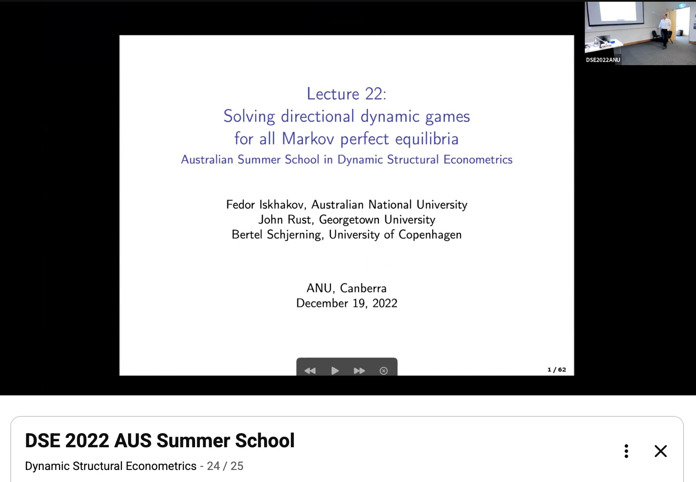

This class is recorded. It continues the [nested RLS estimator of Class 25](25_rls.md#rls-nrls):
maximum likelihood for directional dynamic games with all equilibria in the inner loop,
branch and bound on the RLS tree, and the Monte Carlo evidence.

The recording is a lecture at the DSE 2022 Australian Summer School in Dynamic Structural
Econometrics; the link starts at 1:02:04, where the estimation part begins.

{button}`📺 Watch the lecture recording on YouTube, from 1:02:04 <https://youtu.be/ZBa1ZbOX97g?si=a1FMnRpdeklMV9Y2&t=3724>`

[](https://youtu.be/ZBa1ZbOX97g?si=a1FMnRpdeklMV9Y2&t=3724)

````{note} References and additional resources

(nrls-references)=
- 📖 {cite:t}`nrls` "Structural estimation of dynamic directional games with multiple equilibria"
- 📖 {cite:t}`rls` "Recursive lexicographical search: Finding all Markov perfect equilibria of finite state directional dynamic games"
- 📖 {cite:t}`land1960AutomaticMethodSolving` "An Automatic Method of Solving Discrete Programming Problems"
````
